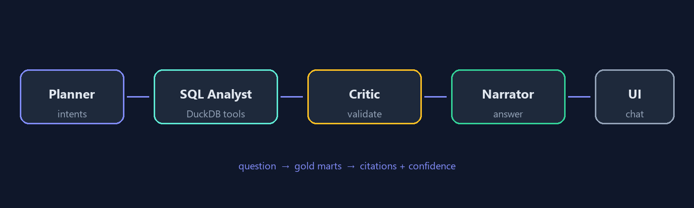

# Agentic Analytics Copilot

Multi-agent **analytics copilot** for commerce gold marts:

**question → planner → SQL analyst (DuckDB tools) → critic → narrator (+ citations)**

Complements the [mini lakehouse](https://github.com/jaimedelope/mini-lakehouse) (medallion marts) with an **agentic consumption layer** — the kind of AI surface stakeholders actually use.

## Live demo

**[agentic-analytics-copilot.vercel.app](https://agentic-analytics-copilot.vercel.app)**

Browser simulation of the agent graph. Docker below runs the real FastAPI + DuckDB tool stack.

## Architecture

```text
User question
     │
     ▼
 ┌─────────┐    intents     ┌──────────────┐
 │ Planner │ ─────────────► │ SQL Analyst  │──► DuckDB gold.* (read-only)
 └─────────┘                └──────────────┘
                                   │
                                   ▼
                            ┌──────────┐
                            │  Critic  │  confidence + row checks
                            └──────────┘
                                   │
                                   ▼
                            ┌──────────┐
                            │ Narrator │  answer + SQL citations
                            └──────────┘
```



| Agent | Job |
|-------|-----|
| **Planner** | Routes NL question to analytics intents (GMV, AOV, funnel, LTV, country, trend) |
| **SQL Analyst** | Runs curated / allow-listed `SELECT` tools against `gold.*` marts |
| **Critic** | Validates tool success, empty results, confidence |
| **Narrator** | Composes the executive answer; optional OpenAI polish if `OPENAI_API_KEY` is set |

Works **without an LLM API key** (deterministic tools + narration). With a key, the narrator can polish tone.

## Quick start

```bash
python -m venv .venv
# Windows: .venv\Scripts\activate
pip install -r requirements.txt
python seed/build_db.py
uvicorn app.main:app --reload --port 8092
```

Open [http://localhost:8092](http://localhost:8092)

Or:

```bash
docker compose up --build
```

## Example questions

- What is our GMV and AOV?
- How is the conversion funnel performing?
- Who are the top customers by LTV?
- Break down revenue by country
- ¿Cuál es el ticket medio y la conversión?

## Project layout

```text
agents/     # planner, SQL tools, critic, narrator graph
app/        # FastAPI + chat UI
seed/       # DuckDB gold mart seed
web/        # static Vercel demo
docs/
```

## Why it belongs on the portfolio

Shows you can ship **agentic AI on real analytics data**: tool use, guardrails (read-only SQL), critique, and explainable traces — not just a chatbot over PDFs.

## Next ideas (v2)

- LangGraph persistence + human-in-the-loop approvals
- Text-to-SQL with constrained grammar + eval harness
- Wire live to the mini-lakehouse DuckDB volume
- Streaming token UI + OpenTelemetry traces
